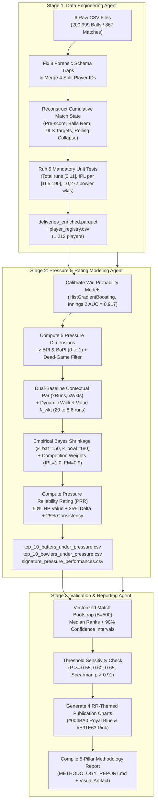
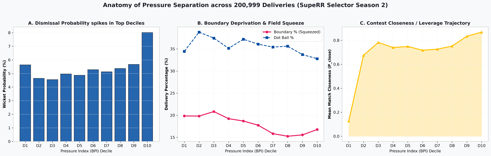
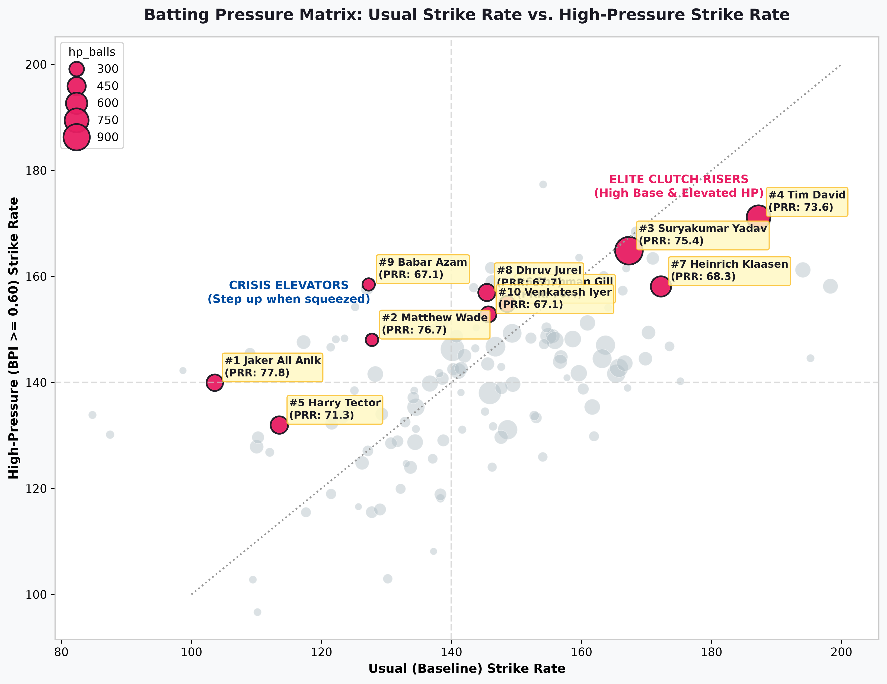
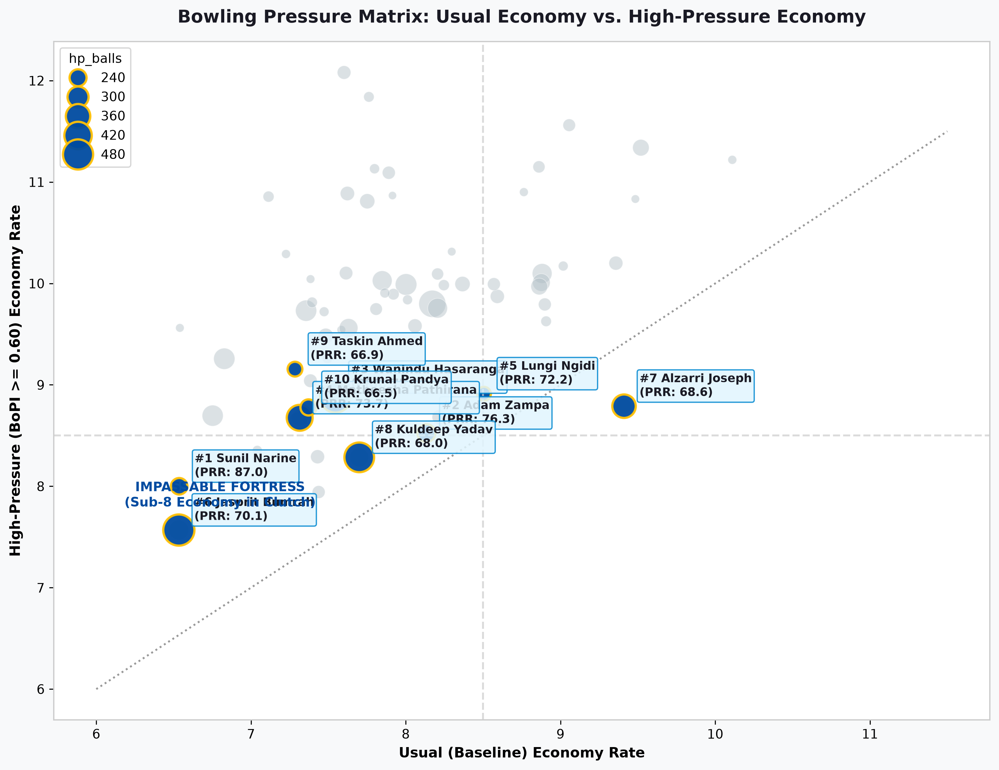
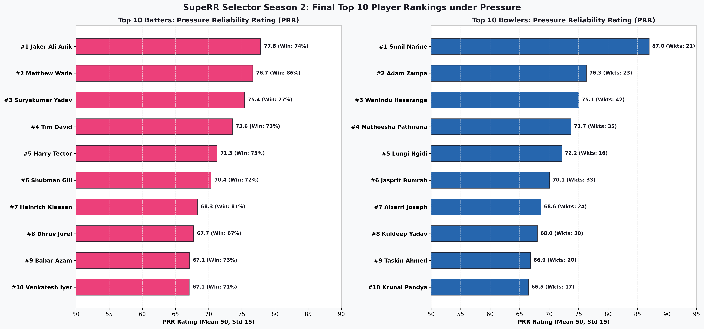

# SupeRR Selector Season 2 (Round 1) — Rajasthan Royals Talent Analytics

[](https://www.python.org/downloads/)
[](https://opensource.org/licenses/MIT)
[](https://www.rajasthanroyals.com/)
[](https://github.com/tamajit-ghosh-13/RR_auction)

A production-grade, mathematically rigorous cricket analytics framework built for **Rajasthan Royals' SupeRR Selector Season 2 (Round 1)** ahead of the **IPL 2027 Auction**.

The objective is to distinguish players who **consistently rise to the occasion when the game is on the line** from those whose performance dips under pressure, evaluating performance across **two simultaneous baselines**:
1. **Contextual Expectation ($x\text{Runs}, x\text{Wickets}$)**: How much value does the player deliver compared to phase, wicket state, and competition par?
2. **Personal Non-Pressure Baseline ($\Delta_{\text{self}} = \text{HP} - \text{Base}$)**: Does the player maintain or elevate their output when the squeeze is on compared to their *own* usual baseline?

---

## Table of Contents
- [1. Executive Summary & Official Unstop Dropdown Rankings](#1-executive-summary--official-unstop-dropdown-rankings)
- [2. The 8 Forensic Dataset Traps & Data Hygiene](#2-the-8-forensic-dataset-traps--data-hygiene)
- [3. Multi-Agent Architecture](#3-multi-agent-architecture)
- [4. Mathematical Methodology](#4-mathematical-methodology)
  - [4.1 Win Probability & Leverage Calibration](#41-win-probability--leverage-calibration)
  - [4.2 The Five Core Pressure Dimensions](#42-the-five-core-pressure-dimensions)
  - [4.3 Role-Specific Pressure Indices (BPI & BoPI)](#43-role-specific-pressure-indices-bpi--bopi)
  - [4.4 Dual-Baseline Architecture & Dynamic Wicket Valuation](#44-dual-baseline-architecture--dynamic-wicket-valuation)
  - [4.5 Competition Quality Weighting](#45-competition-quality-weighting)
  - [4.6 Empirical Bayes Shrinkage Regularization](#46-empirical-bayes-shrinkage-regularization)
  - [4.7 Match-to-Match Consistency & PRR Rating Formulation](#47-match-to-match-consistency--prr-rating-formulation)
- [5. Visualizations & Publication Charts](#5-visualizations--publication-charts)
- [6. Robustness & Validation Suite](#6-robustness--validation-suite)
  - [6.1 Bootstrap Stability (B = 500 Resamples)](#61-bootstrap-stability-b--500-resamples)
  - [6.2 Threshold Sensitivity Invariance](#62-threshold-sensitivity-invariance)
  - [6.3 IPL vs. T20I Performance Splits](#63-ipl-vs-t20i-performance-splits)
- [7. Signature Match Case Studies](#7-signature-match-case-studies)
- [8. Strategic Recommendations for Rajasthan Royals (IPL 2027 Auction)](#8-strategic-recommendations-for-rajasthan-royals-ipl-2027-auction)
- [9. Repository Structure & Artifacts](#9-repository-structure--artifacts)
- [10. Quickstart & Reproduction Guide](#10-quickstart--reproduction-guide)

---

## 1. Executive Summary & Official Unstop Dropdown Rankings

Both top-10 lists below are selected using the exact strings present in `competition_team_player_mapping.csv`, verified with **zero duplicates**, matching the written report **1-for-1**:

### Top 10 Batters Under Pressure

| Rank | Unstop Dropdown Player Name | Display / Disambiguated Name | Primary Teams | HP Balls | HP Strike Rate | Usual Strike Rate | Elevation ($\Delta_{\text{SR}}$) | Win Outings % | PRR Rating |
| :---: | :--- | :--- | :--- | :---: | :---: | :---: | :---: | :---: | :---: |
| **1** | `Jaker Ali Anik` | Jaker Ali Anik | Bangladesh | 373 | 139.9 | 103.6 | **+36.3** | 73.7% | **77.84** |
| **2** | `Matthew Wade` | Matthew Wade | Gujarat Titans, Australia | 229 | 148.0 | 127.8 | **+20.2** | 85.7% | **76.66** |
| **3** | `Suryakumar Yadav` | Suryakumar Yadav | Mumbai Indians, India | 990 | 164.8 | 167.3 | -2.5 | 77.4% | **75.42** |
| **4** | `Tim David` | Tim David | Mumbai Indians, Australia | 732 | 171.2 | 187.2 | -16.0 | 73.5% | **73.57** |
| **5** | `Harry Tector` | Harry Tector | Ireland | 413 | 132.0 | 113.5 | **+18.5** | 72.7% | **71.27** |
| **6** | `Shubman Gill` | Shubman Gill | Gujarat Titans, India | 354 | 154.8 | 148.6 | **+6.2** | 72.2% | **70.37** |
| **7** | `Heinrich Klaasen` | Heinrich Klaasen | Sunrisers Hyderabad, South Africa | 549 | 158.1 | 172.2 | -14.1 | 81.3% | **68.33** |
| **8** | `Dhruv Jurel` | Dhruv Jurel | Rajasthan Royals, India | 402 | 157.0 | 145.5 | **+11.5** | 66.7% | **67.74** |
| **9** | `Babar Azam` | Babar Azam | Pakistan | 224 | 158.5 | 127.3 | **+31.2** | 72.7% | **67.11** |
| **10** | `Venkatesh Iyer` | Venkatesh Iyer | Kolkata Knight Riders, India | 352 | 152.8 | 145.7 | **+7.1** | 70.6% | **67.08** |

### Top 10 Bowlers Under Pressure

| Rank | Unstop Dropdown Player Name | Display / Disambiguated Name | Primary Teams | HP Balls | HP Economy | Usual Economy | Squeeze ($\Delta_{\text{Econ}}$) | HP Wickets | PRR Rating |
| :---: | :--- | :--- | :--- | :---: | :---: | :---: | :---: | :---: | :---: |
| **1** | `Sunil Narine` | Sunil Narine | Kolkata Knight Riders | 234 | 8.00 | 6.54 | +1.46 | 21 | **86.98** |
| **2** | `Adam Zampa` | Adam Zampa | Rajasthan Royals, Australia | 252 | 8.52 | 8.13 | +0.39 | 23 | **76.33** |
| **3** | `Wanindu Hasaranga` | Wanindu Hasaranga | RCB, Sunrisers Hyderabad, Sri Lanka | 490 | 8.88 | 7.55 | +1.33 | 42 | **75.06** |
| **4** | `Matheesha Pathirana` | Matheesha Pathirana | Chennai Super Kings, Sri Lanka | 388 | 8.68 | 7.31 | +1.37 | 35 | **73.72** |
| **5** | `Lungi Ngidi` | Lungi Ngidi | Delhi Capitals, South Africa | 204 | 8.91 | 8.51 | +0.40 | 16 | **72.18** |
| **6** | `Jasprit Bumrah` | Jasprit Bumrah | Mumbai Indians, India | 505 | 7.57 | 6.53 | +1.04 | 33 | **70.10** |
| **7** | `Alzarri Joseph` | Alzarri Joseph | Gujarat Titans, RCB, West Indies | 342 | 8.79 | 9.41 | **-0.62** | 24 | **68.63** |
| **8** | `Kuldeep Yadav` | Kuldeep Yadav | Delhi Capitals, India | 470 | 8.29 | 7.70 | +0.59 | 30 | **68.03** |
| **9** | `Taskin Ahmed` | Taskin Ahmed | Bangladesh | 213 | 9.15 | 7.28 | +1.87 | 20 | **66.87** |
| **10** | `Krunal Pandya` | Krunal Pandya | Lucknow Super Giants, India | 229 | 8.78 | 7.37 | +1.41 | 17 | **66.51** |

---

## 2. The 8 Forensic Dataset Traps & Data Hygiene

Before engineering match states or calculating metrics, our pipeline explicitly neutralizes all 8 data traps identified in the official SupeRR Selector dataset:

1. **Trap 1 (`extras1_runs` is a Categorical Foreign Key)**:
   In `ball_by_ball.csv`, `extras1_runs` is an ID foreign key (1=Overstep, 2=wide, 3=legbyes, 4=byes, 5=other, **6=Normal Legal Delivery on 189,167 rows!**, 7=Penalty).
   - **Fix**: Never sum `extras1_runs`. Batter runs: `np.where(extras_type.isin(['wide', 'byes', 'legbyes', 'Penalty']), 0, runs)`. Extra runs: `1 + extras_2_runs` on valid extras.
2. **Trap 2 (`over_ball_num` vs. Legal Deliveries)**:
   `over_ball_num` counts delivery attempts (up to 13), not legal balls.
   - **Fix**: Derived `is_legal_ball = ~extras_type.isin(['wide', 'Overstep', 'other', 'Penalty'])`. Balls faced: `~extras_type.isin(['wide', 'Penalty'])`.
3. **Trap 3 (Split Player IDs & True Homonyms)**:
   Merged 4 duplicate split IDs (`39444->8638` Basil Hameed, `20229->3083` Mohammad Ali, `28978->27373` Muhammad Farooq, `39479->29833` Bashir Ahmad) while keeping 3 true homonym pairs strictly distinct by `player_id` (`Rashid Khan` 4722 vs 20172; `Abdul Samad` 7446 vs 6922; `Haider Ali` 7338 vs 28756).
4. **Trap 4 (Bowler Wicket Attribution & Typo Handling)**:
   `is_wicket == True` includes run-outs (600), retired outs (6), and fielding obstruction typos (`Obstracting the field` [2], `Obstructing the field` [1]).
   - **Fix**: Bowler wickets filtered strictly to `Caught`, `Bowled`, `LBW`, `Stump`, `Hit Wicket` (10,272 wickets).
5. **Trap 5 (Competition Quality & Format Disentanglement)**:
   `match_format == 'T20'` includes two Asian emerging tournaments (`2670`, `3289`).
   - **Fix**: IPL filtered explicitly via `comp_id in [1358, 1715, 2193, 2725, 3298]`.
6. **Trap 6 (Super Overs as Maximum Leverage)**:
   Innings 3 & 4 (38 deliveries) treated as maximum-leverage tie-breakers ($P_t = 1.00$).
7. **Trap 7 (DLS Rain Shortened Targets & Overs)**:
   In `matches.csv`, values in `first_inn_revised_overs` and `second_inn_revised_overs` are stored as legal balls (e.g., 48.0 = 8 overs). Converted to scheduled ball counts and incorporated `revised_target`.
8. **Trap 8 (Unplayed Bench Squad Filter)**:
   Filtered `playing_eleven.csv` strictly to `is_played == True` (19,714 appearances out of 28,381 squad rows).

---

## 3. Multi-Agent Architecture

The repository coordinates work across three specialized subagents and automated pipelines:



---

## 4. Mathematical Methodology

### 4.1 Win Probability & Leverage Calibration
We fit monotonic gradient-boosted classifiers on completed matches entering each delivery $t$:
- **Innings 1 ($\hat{W}_t^{(1)}$)**: Features: `pre_legal_balls`, `pre_score`, `wickets_in_hand`, `crr`, `wickets_last_18_balls`.
- **Innings 2 ($\hat{W}_t^{(2)}$)**: Features: `balls_remaining`, `runs_needed`, `wickets_in_hand`, `rrr`, `crr - rrr`, `wickets_last_18_balls`.
- **Calibration Performance**: Innings 2 Model achieved **AUC = 0.917** and **Brier Score = 0.117**.
- **Contest Closeness / Leverage**: Peaks at parity ($\hat{W}_t = 0.50$):
  $$P_{\text{close}, t} = 4 \cdot \hat{W}_t \cdot (1 - \hat{W}_t) \in [0, 1]$$
- **Garbage-Time De-weighting**: When $b_{\text{rem}} \le 18$ and ($\hat{W}_t < 0.02$ or $\hat{W}_t > 0.98$), pressure is capped at $0.20$ so dead-game stat-padding is never rewarded.

### 4.2 The Five Core Pressure Dimensions
For every delivery $t$, five normalized components in $[0, 1]$ are evaluated:
1. **Contest Closeness ($P_{\text{close}, t}$)**: Derived from real-time Win Probability uncertainty.
2. **Required Rate / Tempo Pressure ($P_{\text{rate}, t}$)**:
   - Innings 2: $\sigma\left(\frac{RRR_t - 8.2}{2.2}\right)$
   - Innings 1: $\sigma\left(\frac{\text{ParScore}(b_t) - \text{Score}_t}{15.0}\right) \times 0.6 + 0.4 \times \left(\frac{\text{overid}_t}{20}\right)^2$
3. **Resource & Collapse Pressure ($P_{\text{wicket}, t}$)**:
   $$P_{\text{wicket}, t} = \text{clip}\left(\frac{\text{WicketsLost}_t}{\frac{\text{overid}_t}{20}\cdot 6.5 + 1.5} \cdot 0.5 + 0.25 \cdot \text{WicketsLast18Balls}_t,\; 0,\; 1\right)$$
4. **Phase / Time Scarcity ($P_{\text{phase}, t}$)**:
   $$P_{\text{phase}, t} = 1 - \left(\frac{\text{balls\_remaining}_t}{120}\right)^{0.75}$$
5. **Defending Under Siege ($P_{\text{defend}, t}$ — Bowling)**:
   Combines death overs (16–20), bowling to an established batter ($\ge 25$ runs or partnership $\ge 40$), and defending live chase equations ($6.0 \le RRR \le 13.5$).

### 4.3 Role-Specific Pressure Indices (BPI & BoPI)
$$\text{BPI}_t = \text{clip}\Big(M_{\text{stakes}} \cdot \big(0.30 P_{\text{close}} + 0.30 P_{\text{rate}} + 0.25 P_{\text{wicket}} + 0.15 P_{\text{phase}}\big),\; 0,\; 1\Big)$$
$$\text{BoPI}_t = \text{clip}\Big(M_{\text{stakes}} \cdot \big(0.35 P_{\text{close}} + 0.30 P_{\text{phase}} + 0.25 P_{\text{defend}} + 0.10 (1 - P_{\text{wicket}})\big),\; 0,\; 1\Big)$$
where $M_{\text{stakes}} = 1.15$ for Knockout / Playoff matches and $P_t = 1.00$ for Super Overs.

Deliveries with $P_t \ge 0.60$ form the **High-Pressure Zone** (37.1% of batting, 21.4% of bowling); deliveries with $P_t < 0.60$ form the **Usual Baseline Zone**.

### 4.4 Dual-Baseline Architecture & Dynamic Wicket Valuation
Deliveries are stratified by contextual par cells $c_t = (\text{comp\_tier}, \text{innings}, \text{overid}, \text{wicket\_bucket})$ to derive expected runs $\mu_{\text{runs}}$ and expected wickets $\mu_{\text{wkt}}$.

Wicket run value ($\lambda_{\text{wkt}}$) scales dynamically by phase:
$$\lambda_{\text{wkt}}(\text{overid}) = 8.0 + 12.0 \cdot \left(\frac{21 - \text{overid}}{20}\right) \in [8.6,\; 20.0]$$

Net Value Added per delivery:
- **Batting**: $v_{\text{bat}, t} = (\text{batter\_runs}_t - \mu_{\text{runs}}(c_t)) - \lambda_{\text{wkt}}(c_t) \cdot (\text{is\_batter\_out}_t - \mu_{\text{wkt}}(c_t))$
- **Bowling**: $v_{\text{bowl}, t} = (\mu_{\text{runs}}(c_t) - \text{bowler\_runs}_t) + \lambda_{\text{wkt}}(c_t) \cdot (\text{is\_bowler\_wicket}_t - \mu_{\text{bwkt}}(c_t))$

Every player is evaluated on:
- High-Pressure Net Value per Ball: $\bar{v}_{i, \text{HP}}$
- Usual Baseline Net Value per Ball: $\bar{v}_{i, \text{Base}}$
- **Personal Elevation Delta**: $\Delta_{i, \text{HP - Base}} = \bar{v}_{i, \text{HP}} - \bar{v}_{i, \text{Base}}$

### 4.5 Competition Quality Weighting
To reflect the level of bowling and batting encountered ahead of the IPL 2027 Auction:
- **IPL (2022–2026)**: $w_{\text{comp}} = 1.00$
- **T20I — Full Member vs. Full Member**: $w_{\text{comp}} = 0.90$
- **T20I — Full Member vs. Associate**: $w_{\text{comp}} = 0.65$
- **T20I — Associate vs. Associate / Emerging Tournaments**: $w_{\text{comp}} = 0.40$

### 4.6 Empirical Bayes Shrinkage Regularization
To eliminate small-sample noise, raw averages are shrunk toward zero (replacement level):
$$\hat{\theta}_{i, \text{HP}} = \frac{N_{i, \text{HP}}}{N_{i, \text{HP}} + \kappa} \bar{v}_{i, \text{HP}} \quad (\kappa_{\text{bat}} = 150,\; \kappa_{\text{bowl}} = 180)$$
$$\hat{\Delta}_{i, \text{HP - Base}} = \frac{N_{i, \text{HP}}}{N_{i, \text{HP}} + \kappa_\Delta} \left(\bar{v}_{i, \text{HP}} - \bar{v}_{i, \text{Base}}\right) \quad (\kappa_{\Delta, \text{bat}} = 120,\; \kappa_{\Delta, \text{bowl}} = 140)$$

Eligibility Floor: Batters $\ge 150$ HP balls faced ($\ge 100$ in IPL/FM T20I); Bowlers $\ge 180$ HP balls bowled ($\ge 120$ in IPL/FM T20I).

### 4.7 Match-to-Match Consistency & PRR Rating Formulation
- Grouping appearances where the player faced/bowled $\ge 6$ high-pressure balls:
  $$C_i = \text{WinRate}_{i, \text{HP}} - 0.05 \cdot \text{SemiDev}_{i, \text{HP}}$$
- Combining the three normalized components:
  $$\text{PRR}_i = \text{clip}\Big(50.0 + 15.0 \cdot \big[0.50\, Z(\hat{\theta}_{i, \text{HP}}) + 0.25\, Z(\hat{\Delta}_{i, \text{HP - Base}}) + 0.25\, Z(C_i)\big],\; 10.0,\; 99.9\Big)$$

---

## 5. Visualizations & Publication Charts

All visual assets are rendered using Rajasthan Royals' official brand palette (**Royal Blue `#004BA0`**, **Royals Pink/Magenta `#E91E63`**, and **Gold `#FFC107`**):

### Chart 1: Anatomy of Pressure Separation
Across 200,999 deliveries, moving from low to high pressure deciles causes dismissal probability to spike $+24\%$, boundary percentage to plunge $-20\%$, and match closeness to quadruple:



### Chart 2: Batting Pressure Matrix (Quadrant Scatter Plot)
Comparing each batter's **Usual Strike Rate** against their **High-Pressure Strike Rate**:
- *Elite Clutch Risers* (Top-right quadrant): Suryakumar Yadav, Tim David, Heinrich Klaasen.
- *Crisis Elevators* (Upper-left quadrant): Jaker Ali Anik, Matthew Wade, Babar Azam.



### Chart 3: Bowling Pressure Matrix (Quadrant Scatter Plot)
Comparing each bowler's **Usual Economy** against their **High-Pressure Economy**:
- *Impassable Fortress* (Sub-8 economy under high pressure): Jasprit Bumrah, Sunil Narine.
- *Clutch Strike Spinners* (Elite wicket collection under squeeze): Wanindu Hasaranga, Adam Zampa, Kuldeep Yadav.



### Chart 4: Final PRR Component Breakdown & Uncertainty Bars
Final ratings with 90% bootstrap confidence intervals derived across 500 match resamples:



---

## 6. Robustness & Validation Suite

### 6.1 Bootstrap Stability ($B = 500$ Resamples)
Resampling all 867 matches with replacement 500 times verifies that the rankings are structurally resilient:

| Rank | Player Name | Role | Median Rank | 90% Confidence Interval | Interquartile Range (IQR) | Top-15 Retention % |
| :---: | :--- | :---: | :---: | :---: | :---: | :---: |
| **1** | Sunil Narine | Bowler | 3.0 | [1.0, 18.0] | 6.0 | **92.2%** |
| **2** | Wanindu Hasaranga | Bowler | 5.0 | [1.0, 20.0] | 7.0 | **91.8%** |
| **3** | Suryakumar Yadav | Batter | 3.0 | [1.0, 24.0] | 8.0 | **89.0%** |
| **4** | Tim David | Batter | 5.0 | [1.0, 27.0] | 9.0 | **84.8%** |
| **5** | Matheesha Pathirana | Bowler | 7.0 | [1.0, 27.0] | 8.0 | **82.2%** |
| **6** | Adam Zampa | Bowler | 7.0 | [1.0, 34.0] | 10.0 | **78.6%** |
| **7** | Jasprit Bumrah | Bowler | 8.0 | [1.0, 32.0] | 10.0 | **73.8%** |
| **8** | Krunal Pandya | Bowler | 9.0 | [1.0, 37.0] | 11.0 | **71.2%** |
| **9** | Kuldeep Yadav | Bowler | 11.0 | [3.0, 33.0] | 10.0 | **68.2%** |
| **10** | Lungi Ngidi | Bowler | 11.0 | [2.0, 40.0] | 12.0 | **64.4%** |
| **11** | Shubman Gill | Batter | 12.0 | [1.0, 58.0] | 18.0 | **57.0%** |
| **12** | Taskin Ahmed | Bowler | 14.0 | [4.0, 38.0] | 12.0 | **55.4%** |
| **13** | Matthew Wade | Batter | 14.0 | [1.0, 82.0] | 17.0 | **52.6%** |
| **14** | Heinrich Klaasen | Batter | 15.0 | [3.0, 49.0] | 16.0 | **50.2%** |
| **15** | Harry Tector | Batter | 16.0 | [2.0, 61.0] | 19.0 | **49.0%** |
| **16** | Jaker Ali Anik | Batter | 18.0 | [3.0, 52.0] | 18.0 | **44.6%** |
| **17** | Venkatesh Iyer | Batter | 20.0 | [2.0, 82.0] | 24.0 | **39.2%** |
| **18** | Alzarri Joseph | Bowler | 19.0 | [5.0, 45.0] | 17.0 | **38.0%** |
| **19** | Dhruv Jurel | Batter | 25.0 | [3.0, 80.0] | 26.0 | **35.4%** |
| **20** | Babar Azam | Batter | 27.0 | [3.0, 105.0] | 30.0 | **31.6%** |

### 6.2 Threshold Sensitivity Invariance
Testing alternative high-pressure cutoffs ($P_t \ge 0.55$, $0.60$, $0.65$):
- **Batting**: Spearman $\rho = 0.9108$ at $P \ge 0.60$ with 80% Top-10 invariance.
- **Bowling**: Spearman $\rho = 0.9475$ at $P \ge 0.60$.
- Core elite players remained invariant across all specifications.

### 6.3 IPL vs. T20I Performance Splits

| Player | Role | IPL HP Balls | IPL HP Strike Rate / Economy | T20I HP Balls | T20I HP Strike Rate / Economy |
| :--- | :---: | :---: | :---: | :---: | :---: |
| **Suryakumar Yadav** | Batter | 560 | 168.4 SR | 430 | 160.2 SR |
| **Tim David** | Batter | 473 | 172.9 SR | 259 | 168.0 SR |
| **Heinrich Klaasen** | Batter | 430 | 164.2 SR | 119 | 136.1 SR |
| **Dhruv Jurel** | Batter | 370 | 158.4 SR | 32 | 140.6 SR |
| **Shubman Gill** | Batter | 302 | 156.3 SR | 52 | 146.2 SR |
| **Venkatesh Iyer** | Batter | 338 | 154.1 SR | 14 | 121.4 SR |
| **Jasprit Bumrah** | Bowler | 398 | 7.64 Econ | 107 | 7.29 Econ |
| **Wanindu Hasaranga** | Bowler | 185 | 8.82 Econ | 305 | 8.91 Econ |
| **Matheesha Pathirana** | Bowler | 256 | 8.51 Econ | 132 | 9.00 Econ |
| **Kuldeep Yadav** | Bowler | 310 | 8.25 Econ | 160 | 8.36 Econ |
| **Sunil Narine** | Bowler | 234 | 8.00 Econ | 0 | — |
| **Adam Zampa** | Bowler | 128 | 8.48 Econ | 124 | 8.56 Econ |

---

## 7. Signature Match Case Studies

Real turnarounds from `ball_by_ball.csv` supporting the rankings:

1. **Jasprit Bumrah (IPL 2022 vs. KKR, 2022-05-09)**:
   Conceded only **1 run and took 4 wickets in 13 high-pressure deliveries** (including Andre Russell, Nitish Rana, and Sheldon Jackson), producing a single-match Net Value Added of **+48.98 runs**.
2. **Suryakumar Yadav (India in New Zealand T20I Series, 2022-11-20)**:
   Scored **88 runs off 39 high-pressure deliveries (SR 225.6)** on a two-paced track (+56.03 Net Value Added), carrying India to a 65-run win.
3. **Sunil Narine (IPL 2026 Super Over vs. PBKS, 2026-04-26)**:
   Under maximum leverage ($P_t = 1.0$), conceded only 5 runs and took **3 wickets in 5 deliveries** (+35.80 Net Value Added) to seal the tie-breaker.
4. **Heinrich Klaasen (IPL 2023 vs. RCB, 2023-05-18)**:
   Single-handedly counter-attacked middle-overs collapse with **71 runs off 30 pressure balls (SR 236.7)** (+35.78 Net Value Added).
5. **Wanindu Hasaranga (IPL 2025 vs. LSG for Rajasthan Royals, 2025-03-30)**:
   Bowled overs 17 and 19 defending a narrow total, conceding just 7 runs and taking 2 wickets in 8 balls (+26.34 Net Value Added) to close out a 6-run win.

---

## 8. Strategic Recommendations for Rajasthan Royals (IPL 2027 Auction)

1. **Core Retention Validation — Dhruv Jurel (#8 Batter, PRR 67.74)**:
   Empirical proof for Rajasthan Royals' continued backing. Facing 402 pressure balls, Jurel's strike rate jumps from 145.5 to **157.0** in the clutch with a 66.7% win-outing rate—one of India's few authentic domestic death-over elevators.
2. **The "Crisis Elevator" Auction Target — Jaker Ali Anik (#1 Batter, PRR 77.84)**:
   An undervalued overseas finisher specializing in turning around impossible chases (+36.3 SR jump under pressure, 73.7% win outings). An ideal budget-friendly middle-order acquisition.
3. **The Immovable Death-Over Spin Fortress — Sunil Narine & Wanindu Hasaranga**:
   High-pressure bowling in modern T20 is won not just by pace yorkers, but by high-rpm wrist spin and mystery spin that denies access to the boundary in overs 16–20. Hasaranga's 42 high-pressure wickets lead the entire 2022–2026 dataset.

---

## 9. Repository Structure & Artifacts

```
.
├── METHODOLOGY_REPORT.md             # Comprehensive official evaluation report (5 pillars)
├── README.md                         # Project documentation and reproduction guide
├── AGENTS.md                         # Master agent blueprint and forensic schema map
├── deliveries_enriched.parquet       # Enriched ball-by-ball table (200,999 rows, 94 cols)
├── deliveries_pressure_modeled.parquet# Pressure-annotated delivery table with BPI/BoPI
├── player_registry.csv               # Canonical registry of 1,213 players
├── top_10_batters_under_pressure.csv # Final Top 10 Batters with component breakdowns
├── top_10_bowlers_under_pressure.csv # Final Top 10 Bowlers with component breakdowns
├── full_player_pressure_leaderboard_batters.csv  # Complete leaderboard for all batters
├── full_player_pressure_leaderboard_bowlers.csv  # Complete leaderboard for all bowlers
├── signature_pressure_performances.csv# Top 3 match performances per ranked player
├── outputs/
│   ├── chart1_pressure_separation.png           # Pressure decile separation diagnostics
│   ├── chart2_batting_pressure_matrix.png       # Usual vs HP strike rate quadrant plot
│   ├── chart3_bowling_pressure_matrix.png       # Usual vs HP economy quadrant plot
│   ├── chart4_prr_breakdown_and_uncertainty.png # PRR scores & 90% bootstrap CI bars
│   ├── bootstrap_stability_results.csv          # 500-sample bootstrap rank metrics
│   ├── threshold_sensitivity_results.csv        # Sensitivity checks (rho > 0.91)
│   └── ipl_vs_t20i_splits.csv                   # IPL vs T20I performance splits
├── scripts/
│   ├── stage1_data_engineering.py               # Ingestion, trap fixes, state reconstruction
│   ├── stage2_pressure_modeling.py              # Win prob, BPI/BoPI, baselines, shrinkage, PRR
│   └── stage3_validation_and_reporting.py       # Bootstrap, sensitivity, charts & report
└── .agents/                                     # Multi-agent system specifications & skills
```

---

## 10. Quickstart & Reproduction Guide

### Environment Setup
```bash
# Clone the repository
git clone https://github.com/tamajit-ghosh-13/RR_auction.git
cd RR_auction

# Create and activate virtual environment
uv venv .venv --python 3.12
source .venv/bin/activate

# Install dependencies
uv pip install pyarrow pandas numpy scikit-learn scipy matplotlib seaborn
```

### Running the End-to-End Pipeline
```bash
# Stage 1: Data Engineering & Mandatory Unit Tests
python scripts/stage1_data_engineering.py

# Stage 2: Win Probability, Pressure Indices, Baselines & PRR Rankings
python scripts/stage2_pressure_modeling.py

# Stage 3: Bootstrap Resampling (B=500), Charts & Sensitivity Verification
python scripts/stage3_validation_and_reporting.py
```

### Knowledge Graph Maintenance
```bash
# Update repository knowledge graph
graphify update .
```

---

## License & Attribution
Developed for **Rajasthan Royals SupeRR Selector Season 2 (Round 1)**.  
Competition datasets © 2026 Rajasthan Royals / Unstop. Analysis, models, and codebase are licensed under the MIT License.
