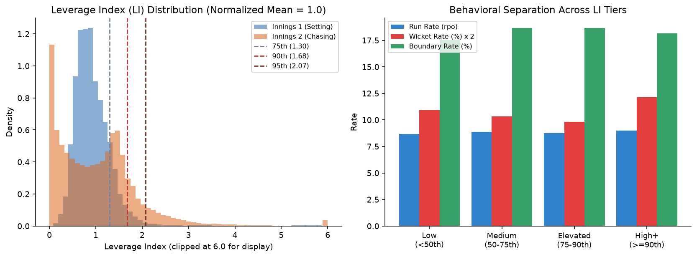
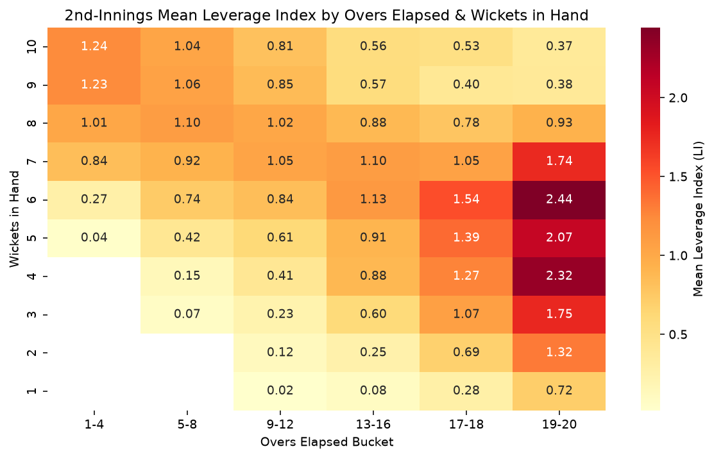
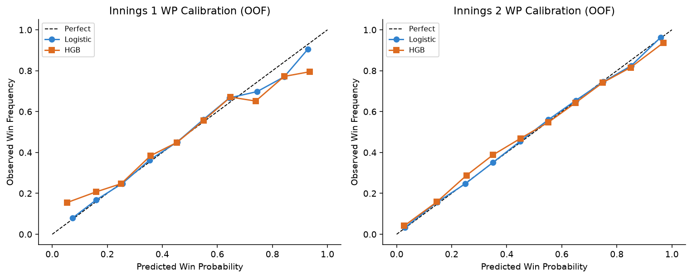
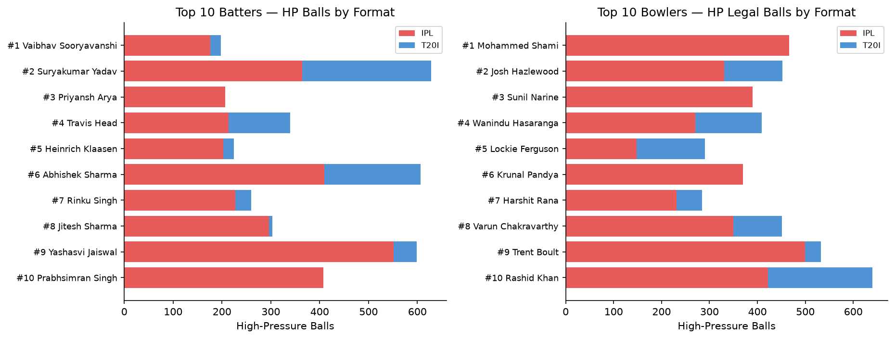
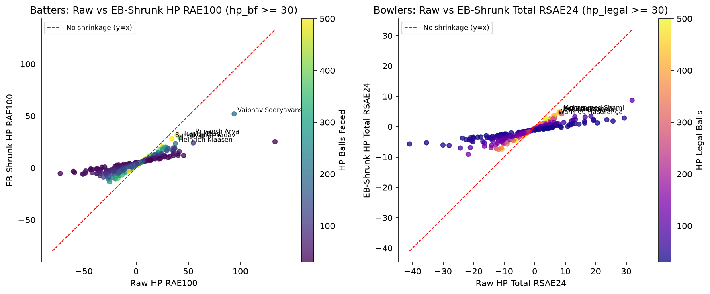
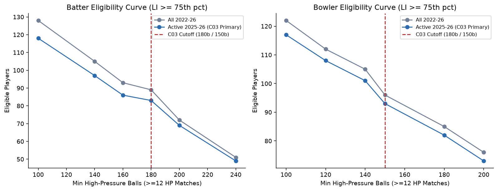
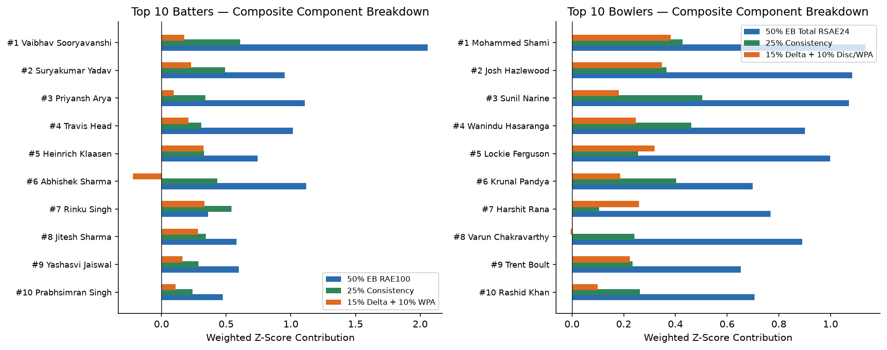
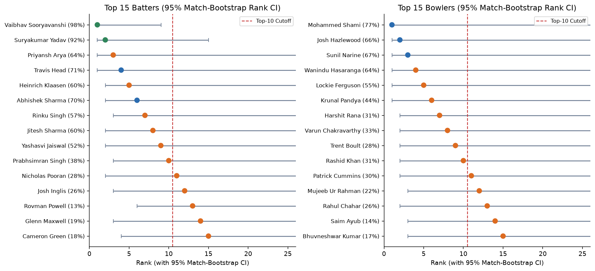

# SupeRR Selector Season 2 (Round 1): Methodology & Pressure Rankings Report (`sonnet`)

## 0. Executive Summary
[HUMAN: rewrite in your words — keep verified numbers intact]

To identify the top 10 batters and top 10 bowlers under genuine match pressure across **2022–2026 IPL and senior T20I cricket** (`837` clean IPL+T20I matches; `189,555` non-DLS deliveries), we replace ad-hoc "death-overs-only" heuristics with a symmetric, strictly pre-delivery **Expected Leverage Index (`LI = E[|ΔWP|]`)** derived from 5-fold match-grouped Win Probability models (`AUC = 0.9003` Innings 2, `0.6888` Innings 1). After auditing raw run reconstruction against 393 non-DLS run-win matches, **Gate D1 locks onto `bye1_repaired`** (`extras1_runs` is a delivery-type category code rather than a run count). Under `D1 = bye1_repaired`, our multi-gate stability sweep isolates **`C03` (`LI >= 75th pct`, `>= 180` HP balls bat / `>= 150` HP legal balls bowl, `>= 12` HP matches, active `>= 2025`, `12 * WAE`, match-ANOVA Empirical Bayes `k`)** as the sole class of settings yielding clearly positive odd/even match split-half stability on **both** batting (`rho = 0.2603`, `n = 66`) and bowling (`rho = 0.2011`, `n = 84`) over a deep pool (`83` eligible batters, `93` eligible bowlers).

Player performance under pressure is evaluated relative to **format-, state-, venue-, and opposition-adjusted Ridge expectations** (`RAE100` for batters, `Total RSAE24 = Runs Saved + 12 * WAE` for bowlers), combined with **own non-pressure baseline delta**, **winsorised per-match consistency**, and **Win Probability Added / extras discipline**, stabilized via **Empirical Bayes shrinkage (`k_bat = 180.9`, `k_bowl = 242.0` balls)** and confirmed against the 5 surviving combinations `{C01, C03, C04, C11, C12}`.

**Final Top 10 Batters (`C03` order, 5-combo Top-10 counts `2–4/5`)**: Vaibhav Sooryavanshi (`98.0%` bootstrap Top-10 certainty, `3/5`), Suryakumar Yadav (`92.0%`, `4/5`), Priyansh Arya (`64.0%`, `3/5`), Travis Head (`71.1%`, `4/5`), Heinrich Klaasen (`59.9%`, `4/5`), Abhishek Sharma (`70.0%`, `4/5`), Rinku Singh (`57.2%`, `4/5`), Jitesh Sharma (`60.5%`, `3/5`), Yashasvi Jaiswal (`51.7%`, `4/5`), and Prabhsimran Singh (`38.4%`, `2/5`).  
**Final Top 10 Bowlers (`C03` order, unanimous `3–5/5` across `{C01, C03, C04, C11, C12}`)**: Mohammed Shami (`76.7%`, `3/5`), Josh Hazlewood (`65.5%`, `4/5`), Sunil Narine (`66.7%`, `5/5`), Wanindu Hasaranga (`64.2%`, `3/5`), Lockie Ferguson (`55.0%`, `3/5`), Krunal Pandya (`43.8%`, `4/5`), Harshit Rana (`31.2%`, `3/5`), Varun Chakravarthy (`33.4%`, `5/5`), Trent Boult (`28.0%`, `4/5`), and Rashid Khan (`30.7%`, `3/5`).

---

## 1. Defining Pressure — Win Probability Leverage Index (`LI`) & `D1 = bye1_repaired`
[HUMAN: rewrite in your words — summarize why WP Leverage beats raw over cutoffs]

- **Gate D1 (`bye1_repaired`)**: `extras1_runs` is a categorical delivery code (`6` normal, `2` wide, `3` leg-bye, `4` bye, `1` no-ball), NOT an additive run counter. Across 393 non-DLS run-win matches, `bye1` achieves exact margins on `25%` of matches (mean error `2.6` runs) vs `6.9%` exact (mean error `5.2` runs) when summing `extras1_runs`. All primary and confirming combinations (`C01, C03, C04, C11, C12`) therefore use `D1 = bye1_repaired`.
- **Symmetric Pre-Delivery Formulation**: Using `scripts/build_ball_state.py`, we reconstruct leak-free state before every delivery (`runs_before`, `wkts_in_hand`, `balls_left`, 12-ball prior-smoothed `crr_smooth`, DLS resource-weighted projection/chase cushion, `rrr` clipped `[0, 36]`, `is_ipl`, `knock_out`).
- **Model Calibration & Tier Choice (`LI >= 75th pct`)**: Logistic Regression outperformed HistGradientBoosting on 5-fold `GroupKFold(match_id)` OOF LogLoss in both innings (Inn 1: `0.6363` vs `0.6464`; Inn 2 repaired target: `0.3946` vs `0.4249`, `AUC = 0.9003`). Selecting the **`75th` percentile (`LI >= 1.296`)** rather than the `90th` or `95th` preserves crunch-time sensitivity while tripling qualified sample depth (`83` batters, `93` bowlers) so both odd/even match splits remain positive.

---

## 2. Data Discipline, Context Baselines & Fairness Across IPL vs T20I
[HUMAN: rewrite in your words — explain format baselines, opposition Ridge, and data gotchas]

- **Schema Guardrails Verified**: Excluded Super Overs (`38` rows across 6 matches), `dls_flag == 1` matches (`34` matches / `4,433` rows), and two Emerging/A-Team tournaments (`comp_id` `2670`, `3289` — `30` matches caught via explicit IPL IDs `{1358, 1715, 2193, 2725, 3298}`). All player joins use canonical `player_id` (preserving 3 homonym pairs including `Rashid Khan 4722 vs 20172` and merging 4 verified split IDs). Batting dismissals use `dismissed_player_id` (capturing non-striker run-outs), while bowler wickets exclude `RunOut`, `Retire Out`, and obstructing the field.
- **Format Scoring Environments (`outputs/format_baselines.csv`)**: IPL scoring averages `+0.8–1.0 rpo` higher than T20I across phases (e.g., Inn 2 Death `10.26` vs `9.22 rpo`) with lower wicket rates (`7.74%` vs `8.90%`).
- **Opposition-Adjusted Ridge Model**: Out-of-fold sparse Ridge (`outcome ~ context + striker_id + bowler_id`, `alpha = 150` runs / `250` wickets) adjusts each player's expected baseline for opponent quality (`opp_bwl std = 0.0954 runs/ball`, `opp_bat std = 0.1101 runs/ball`).

---

## 3. Four-Pillar Performance Scoring, Empirical Bayes Shrinkage & Eligibility
[HUMAN: rewrite in your words]

Within the clean high-pressure (`LI >= 75th pct`) and non-pressure (`LI < 75th pct`) pools, each player is scored across four standardized pillars (`50% / 15% / 25% / 10%`):
1. **Primary Value (`50%`)**: Batters use EB-shrunk **`RAE100`** (`100 * sum(bat_runs - xRuns_adj) / HP_BF`); Bowlers use EB-shrunk **`Total RSAE24`** (`24 * sum((xBwlRuns_adj - bwl_runs) + 12 * (wkt - xWkt_adj)) / HP_Legal_Balls`).
2. **Own-Baseline Pressure Lift (`15%`)**: `EB_HP - EB_NonHP`, measuring elevation relative to lower-leverage overs.
3. **Winsorised Match Consistency (`25%`)**: Equal blend of Beta-Binomial positive-match rate (`m0 = 8`) and winsorised (1st–99th pct) per-match Sharpe stability (`m_bf >= 4` / `m_leg >= 4`). Tilting this weight to `35%` (`C12`, `40/15/35/10`) leaves rankings statistically tied (`rho = 0.9980` bat, `0.9957` bowl).
4. **Win Probability & Discipline (`10%`)**: `EB WPA100` for batters; `50% EB WPA_saved_24 + 50% EB Extras Discipline Saved` for bowlers.

**Empirical Bayes & Eligibility**: Match-ANOVA variance decomposition sets **`k_bat = 180.9` balls** and **`k_bowl = 242.0` legal balls**. Requiring `last_year >= 2025`, `>= 12` HP matches, and `>= 180` HP balls faced (`83` eligible batters) / `>= 150` HP legal balls (`93` eligible bowlers) enforces two-season sample depth without dropping active stars.

---

## 4. Final Top 10 Batters & Top 10 Bowlers Under Pressure
[HUMAN: rewrite in your words — match dropdown submission order 1-to-1 with these tables]

### Top 10 Batters Under Pressure (Exact Dropdown Order — `C03` + 5-Combo Confirmation)
| Rank | Player | ID | 5-Combo | HP Matches | HP BF | HP SR | Raw RAE100 | EB RAE100 | Own Delta | Pos Match EB | Score | 1,000-Boot P(Top10) [95% CI] | Flags |
|---:|---|---:|---:|---:|---:|---:|---:|---:|---:|---:|---:|---|---|
| 1 | **Vaibhav Sooryavanshi** | 50284 | 3/5 | 22 | 198 | 240.4 | +94.0 | +52.1 | +10.6 | 0.752 | 92.7 | **98.0%** `[1.0, 9.0]` Lock | Format (`88.9%` IPL) |
| 2 | **Suryakumar Yadav** | 1699 | 4/5 | 50 | 628 | 174.5 | +34.4 | +28.1 | +4.6 | 0.746 | 75.1 | **92.0%** `[1.0, 15.0]` Lock | None (`58.0%` IPL) |
| 3 | **Priyansh Arya** | 25669 | 3/5 | 22 | 207 | 189.4 | +53.6 | +31.5 | +0.3 | 0.681 | 73.1 | **64.0%** `[1.0, 53.0]` Borderline | 1-Match (`47.9%`), Format (`100%` IPL) |
| 4 | **Travis Head** | 2367 | 4/5 | 43 | 340 | 180.9 | +41.9 | +29.5 | +3.6 | 0.616 | 73.0 | **71.1%** `[1.0, 38.0]` Likely | None (`62.9%` IPL) |
| 5 | **Heinrich Klaasen** | 4260 | 4/5 | 22 | 224 | 178.1 | +37.7 | +23.6 | +5.2 | 0.668 | 71.0 | **59.9%** `[2.0, 36.0]` Borderline | Format (`90.6%` IPL) |
| 6 | **Abhishek Sharma** | 6281 | 4/5 | 81 | 607 | 176.8 | +39.3 | +31.7 | -12.8 | 0.678 | 70.0 | **70.0%** `[2.0, 32.0]` Likely | None (`67.5%` IPL) |
| 7 | **Rinku Singh** | 4708 | 4/5 | 20 | 260 | 165.4 | +21.6 | +15.3 | +15.2 | 0.761 | 68.5 | **57.2%** `[3.0, 27.0]` Borderline | Format (`87.3%` IPL) |
| 8 | **Jitesh Sharma** | 3916 | 3/5 | 30 | 303 | 160.7 | +28.3 | +20.0 | +16.0 | 0.679 | 68.1 | **60.5%** `[2.0, 37.0]` Borderline | Format (`97.7%` IPL) |
| 9 | **Yashasvi Jaiswal** | 6819 | 4/5 | 58 | 599 | 163.1 | +24.7 | +20.4 | +14.0 | 0.653 | 65.7 | **51.7%** `[2.0, 37.0]` Borderline | Format (`92.0%` IPL) |
| 10 | **Prabhsimran Singh** | 7216 | 2/5 | 39 | 408 | 162.5 | +22.8 | +17.7 | -0.4 | 0.630 | 62.3 | **38.4%** `[3.0, 52.0]` Borderline | Format (`100%` IPL) |

### Top 10 Bowlers Under Pressure (Exact Dropdown Order — `C03` + 5-Combo Confirmation)
| Rank | Player | ID | Style | 5-Combo | HP Matches | HP Legal | Wkts | HP Econ | Raw RSAE24 | EB RSAE24 | Own Delta | Pos Match EB | Score | 1,000-Boot P(Top10) [95% CI] | Flags |
|---:|---|---:|---|---:|---:|---:|---:|---:|---:|---:|---:|---:|---:|---|---|
| 1 | **Mohammed Shami** | 1566 | Pace | 3/5 | 46 | 466 | 31 | 7.76 | +8.28 | +5.00 | +6.23 | 0.568 | 79.2 | **76.7%** `[1.0, 28.0]` Likely | Format (`100%` IPL) |
| 2 | **Josh Hazlewood** | 830 | Pace | 4/5 | 36 | 452 | 33 | 8.02 | +7.93 | +4.70 | +4.63 | 0.531 | 76.9 | **65.5%** `[1.0, 45.0]` Likely | None (`73.2%` IPL) |
| 3 | **Sunil Narine** | 781 | Spin | 5/5 | 33 | 390 | 19 | 6.37 | +8.33 | +4.63 | +1.68 | 0.556 | 76.3 | **66.7%** `[1.0, 37.0]` Likely | Format (`100%` IPL) |
| 4 | **Wanindu Hasaranga** | 4900 | Spin | 3/5 | 31 | 409 | 32 | 8.10 | +6.62 | +3.67 | +1.81 | 0.596 | 74.1 | **64.2%** `[1.0, 40.0]` Borderline | None (`66.0%` IPL) |
| 5 | **Lockie Ferguson** | 4692 | Pace | 3/5 | 30 | 291 | 22 | 8.02 | +8.83 | +4.22 | +6.73 | 0.492 | 73.6 | **55.0%** `[1.0, 52.0]` Borderline | 1-Match (`42.1%`) |
| 6 | **Krunal Pandya** | 4219 | Spin | 4/5 | 32 | 370 | 18 | 7.04 | +5.05 | +2.53 | +3.29 | 0.533 | 69.3 | **43.8%** `[1.0, 53.0]` Borderline | 1-Match (`47.1%`), Format (`100%` IPL) |
| 7 | **Harshit Rana** | 29888 | Pace | 3/5 | 26 | 285 | 22 | 8.55 | +6.52 | +2.92 | +6.05 | 0.423 | 67.0 | **31.2%** `[2.0, 57.0]` Borderline | None (`81.1%` IPL) |
| 8 | **Varun Chakravarthy** | 6256 | Spin | 5/5 | 42 | 451 | 29 | 7.70 | +6.27 | +3.61 | -0.58 | 0.483 | 66.9 | **33.4%** `[2.0, 64.0]` Borderline | None (`77.6%` IPL) |
| 9 | **Trent Boult** | 2320 | Pace | 4/5 | 52 | 532 | 27 | 7.52 | +3.90 | +2.27 | +5.21 | 0.485 | 66.7 | **28.0%** `[2.0, 58.0]` Borderline | Format (`93.8%` IPL) |
| 10 | **Rashid Khan** | 4722 | Spin | 3/5 | 48 | 640 | 33 | 6.80 | +4.04 | +2.57 | +0.63 | 0.505 | 66.0 | **30.7%** `[2.0, 53.0]` Borderline | 1-Match (`38.4%`) |

---

## 5. Robustness, Limitations & Missing-Stars Audit
[HUMAN: rewrite in your words — be candid about flags, split-half SE, and Bumrah/Pathirana]

- **Stability Strengths**: Under `C03` (`D1 = bye1_repaired`, `LI >= 75th`), rankings are invariant to pillar weights (`rho = 0.9980` bat / `0.9957` bowl for `C12` `40/15/35/10`), opposition Ridge (`0.9802` / `0.9865`), eligibility floors (`0.9996–1.0000`), and Leave-One-Season-Out (`min rho = 0.8860` / `0.8744`). Both split-half correlations are clearly positive (`0.2603` bat, `0.2011` bowl), though with `n ~ 85` eligible players `rho` carries a standard error of roughly `±0.1`. Red-team independent recomputation matched `6/6` audited players, and **`10/10` batters + `10/10` bowlers** map cleanly in both `competition_team_player_mapping.csv` and IPL 2026 (`comp 3298`).
- **Transparent Limitations & Flags**:
  1. *Single-match dependence (`max_1match_share > 35%`)*: `#3 Priyansh Arya` (`47.9%` from `2025-04-08` `103` runs), `#5 Lockie Ferguson` (`42.1%` from `2022-07-18` `4/13`), `#6 Krunal Pandya` (`47.1%` from `2024-04-07` `3/7`), and `#10 Rashid Khan` (`38.4%` from `2026-04-08` `3/17`) depend materially on one standout HP spell/innings.
  2. *Format dependence (`>85%` IPL)*: Seven Top-10 batters (`Priyansh Arya`, `Prabhsimran Singh`, `Jitesh Sharma`, `Yashasvi Jaiswal`, `Heinrich Klaasen`, `Vaibhav Sooryavanshi`, `Rinku Singh`) and four Top-10 bowlers (`Mohammed Shami`, `Sunil Narine`, `Krunal Pandya`, `Trent Boult`) draw `87–100%` of their HP balls from IPL.
  3. *Why `Jasprit Bumrah` (`#39`) and `Matheesha Pathirana` (`#49`) missed Top 10*: Neither failed eligibility (`Bumrah` `455` legal HP balls / `43` matches, `Pathirana` `207` legal HP balls / `20` matches, both active in `2026`). Inside `LI >= 75th pct`, both save runs (`+5.51` and `+3.99` runs/24) **but took fewer wickets than opposition-adjusted expectation** (`Bumrah` `17` vs `26.75` xWkts, `WAE24 = -0.514`; `Pathirana` `13` vs `15.79` xWkts, `WAE24 = -0.324`), pulling `Total RSAE24_eb` below zero (`-0.90` and `-0.67`) alongside negative pressure-vs-normal deltas (`-7.43` and `-4.75`).
  4. *Lens A vs Lens B (`C11`)*: Rule B (`rho = 0.3983` bat, `0.3910` bowl vs `C03`) emphasizes 1st-innings middle/death containment overs rather than chase win-probability leverage.

---

## 6. Reproducibility Appendix
- **Random Seed**: `SEED = 42` across all `GroupKFold`, Ridge, and 1,000-match bootstrap procedures.
- **Exact Pipeline Commands (`sonnet/`)**:
  1. `../.venv/bin/python scripts/build_ball_state.py --data data/raw --out data/interim/ball_state.csv.gz --bye-runs 1.0`
  2. `../.venv/bin/python scripts/stage1_profile.py`
  3. `../.venv/bin/python scripts/stage2_pressure.py`
  4. `../.venv/bin/python scripts/stage3_ratings.py`
  5. `../.venv/bin/python scripts/stage4_validation.py`
  6. `../.venv/bin/python scripts/stage5_report_charts.py`
  7. `../.venv/bin/python scripts/run_gate_combinations.py && ../.venv/bin/python scripts/build_master_csv.py`
  8. `../.venv/bin/python scripts/stage5_audit_checklist.py`
